<p align="center">
  <picture>
    <source media="(prefers-color-scheme: dark)" srcset="assets/readme/banner-dark.svg">
    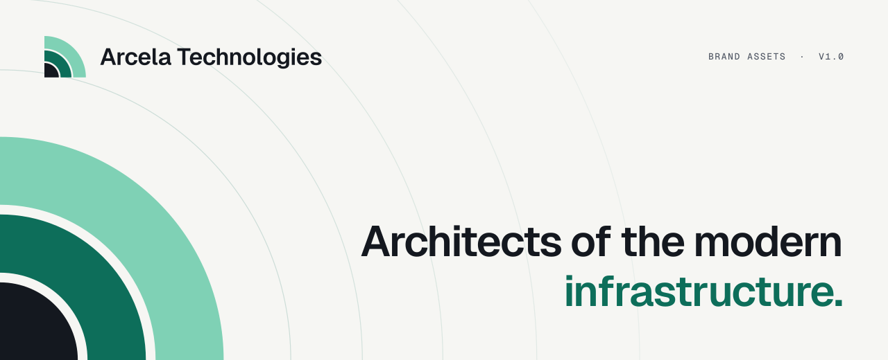
  </picture>
</p>

<p align="center">
  
  
  
  
</p>

<p align="center">
  <a href="#logo"><b>Logo</b></a> &nbsp;·&nbsp;
  <a href="#colour"><b>Colour</b></a> &nbsp;·&nbsp;
  <a href="#typography"><b>Typography</b></a> &nbsp;·&nbsp;
  <a href="#icons"><b>Icons</b></a> &nbsp;·&nbsp;
  <a href="#social"><b>Social</b></a> &nbsp;·&nbsp;
  <a href="#wallpapers"><b>Wallpapers</b></a> &nbsp;·&nbsp;
  <a href="#using-the-brand"><b>Using the brand</b></a>
</p>

<br>

The official logos, colours and artwork for **Arcela Technologies Ltd**. If you're writing about us, listing us as a supplier or linking to our work, everything you need is here, in the right colours and at the right size.

> [!TIP]
> **Just need the logo?** Use [`arcela-lockup.svg`](logo/svg/arcela-lockup.svg) on light backgrounds and [`arcela-lockup-colour-dark.svg`](logo/svg/arcela-lockup-colour-dark.svg) on dark ones. SVG scales to any size without blurring.

<br>

## Logo

The mark is three bands drawn from one corner, with the wordmark set in Geist SemiBold beside it. Always use the supplied files. Never retype the name in a font to recreate it.

<table>
  <tr>
    <td width="50%">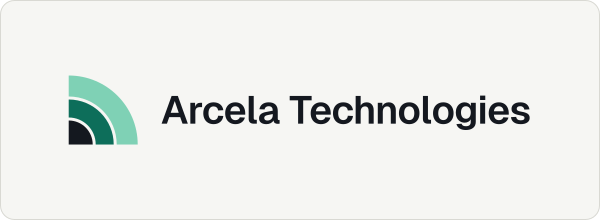</td>
    <td width="50%">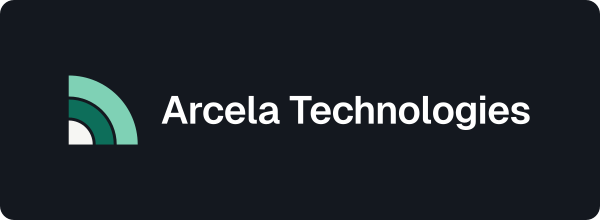</td>
  </tr>
  <tr>
    <td><b>Colour</b>: for white and light backgrounds<br><a href="logo/svg/arcela-lockup.svg"><code>SVG</code></a> <a href="logo/png/arcela-lockup-1600.png"><code>PNG</code></a></td>
    <td><b>Colour, dark</b>: for ink and dark backgrounds<br><a href="logo/svg/arcela-lockup-colour-dark.svg"><code>SVG</code></a> <a href="logo/png/arcela-lockup-colour-dark-1600.png"><code>PNG</code></a></td>
  </tr>
  <tr>
    <td></td>
    <td>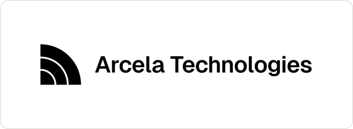</td>
  </tr>
  <tr>
    <td><b>White</b>: for photos and brand green<br><a href="logo/svg/arcela-lockup-white.svg"><code>SVG</code></a> <a href="logo/png/arcela-lockup-white-1600.png"><code>PNG</code></a></td>
    <td><b>Black</b>: for one-colour print, stamps and engraving<br><a href="logo/svg/arcela-lockup-black.svg"><code>SVG</code></a> <a href="logo/png/arcela-lockup-black-1600.png"><code>PNG</code></a></td>
  </tr>
</table>

**The mark on its own** is for small or square spaces such as avatars, favicons and app icons:
[`colour`](logo/svg/arcela-mark.svg) · [`colour, dark`](logo/svg/arcela-mark-colour-dark.svg) · [`white`](logo/svg/arcela-mark-white.svg) · [`black`](logo/svg/arcela-mark-black.svg)

PNGs come in three sizes: lockups at 800, 1600 and 3200 px wide, and marks at 256, 512 and 1024 px. All are in [`logo/png`](logo/png).

### Clear space and minimum size

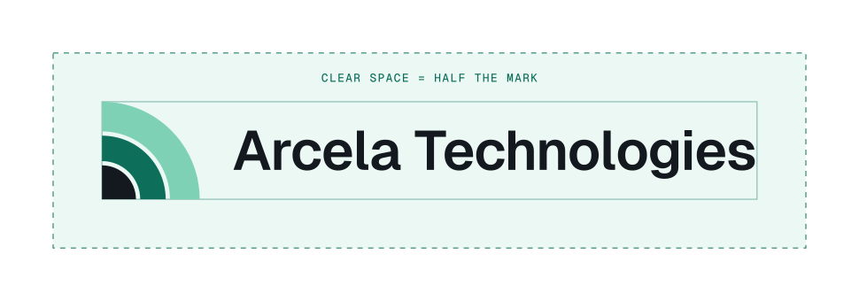

- **Clear space:** keep at least **half the height of the mark** free on every side.
- **Minimum size:** the full lockup no smaller than **120 px** on screen or **30 mm** in print. Below that, use the mark on its own.

<br>

## Colour

<table>
  <tr><th></th><th align="left">Name</th><th align="left">HEX</th><th align="left">RGB</th><th align="left">Use</th></tr>
  <tr><td></td><td><b>Ink</b></td><td><code>#14181F</code></td><td>20 · 24 · 31</td><td>Text, the dark band of the mark</td></tr>
  <tr><td></td><td><b>Green</b></td><td><code>#0D6E5A</code></td><td>13 · 110 · 90</td><td>Buttons, links, the middle band</td></tr>
  <tr><td></td><td><b>Mint</b></td><td><code>#7FD1B5</code></td><td>127 · 209 · 181</td><td>The outer band, highlights</td></tr>
  <tr><td></td><td><b>Paper</b></td><td><code>#F6F6F3</code></td><td>246 · 246 · 243</td><td>Page backgrounds</td></tr>
</table>

<details>
<summary><b>Supporting colours</b></summary>
<br>
<table>
  <tr><th></th><th align="left">Name</th><th align="left">HEX</th><th align="left">Use</th></tr>
  <tr><td></td><td>Slate</td><td><code>#4F5663</code></td><td>Secondary text</td></tr>
  <tr><td></td><td>Ink 2</td><td><code>#3B4150</code></td><td>Muted headings</td></tr>
  <tr><td></td><td>Green hover</td><td><code>#0A5545</code></td><td>Hover and pressed states</td></tr>
  <tr><td></td><td>Line</td><td><code>#D9D9D3</code></td><td>Rules and borders</td></tr>
  <tr><td></td><td>White</td><td><code>#FFFFFF</code></td><td>Cards and surfaces</td></tr>
</table>
</details>

Ready to drop into code: [`colours/arcela.css`](colours/arcela.css) (CSS variables) and [`colours/arcela.json`](colours/arcela.json).

```css
@import url("colours/arcela.css");

.button { background: var(--arcela-green); color: var(--arcela-white); }
```

<br>

## Typography

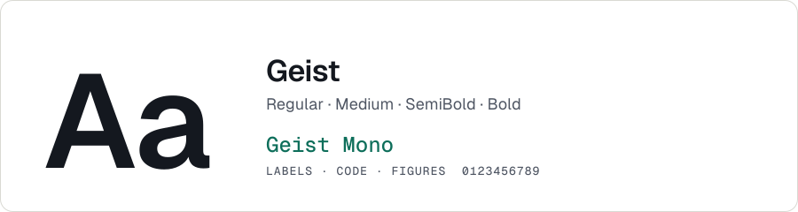

- **[Geist](https://vercel.com/font)** for everything: headings in SemiBold, body text in Regular.
- **[Geist Mono](https://vercel.com/font)** for small labels, code and figures, often in capitals with a little extra letter spacing.

Both are free and open source under the SIL Open Font License.

<br>

## Icons

| File | Size | For |
|---|---|---|
| [`favicon.ico`](icons/favicon.ico) | 16 · 32 · 48 | Browsers |
| [`favicon.svg`](icons/favicon.svg) | Scalable | Modern browsers |
| [`apple-touch-icon.png`](icons/apple-touch-icon.png) | 180 × 180 | iPhone and iPad home screens |
| [`icon-192.png`](icons/icon-192.png) · [`icon-512.png`](icons/icon-512.png) | 192 · 512 | Web app manifests |
| [`icon-maskable-512.png`](icons/icon-maskable-512.png) | 512 × 512 | Android adaptive icons |

<br>

## Social

| | File | Size |
|---|---|---|
| 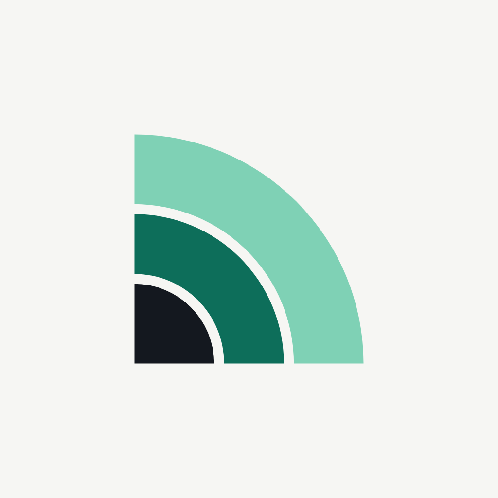 | [`avatar-1024.png`](social/avatar-1024.png) | 1024 × 1024 |
| 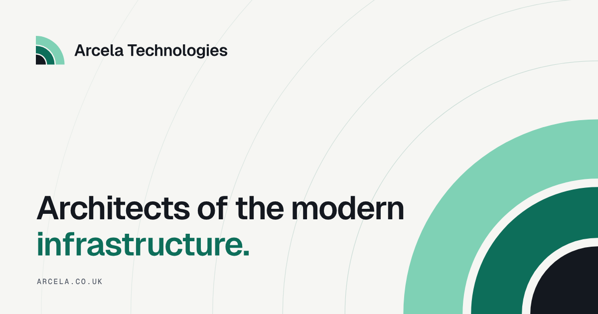 | [`og-image-1200x630.png`](social/og-image-1200x630.png) | Link previews |
| 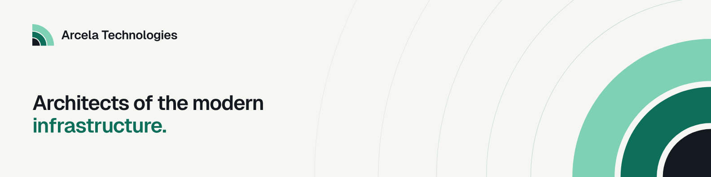 | [`linkedin-banner-1584x396.png`](social/linkedin-banner-1584x396.png) | LinkedIn banner |
| 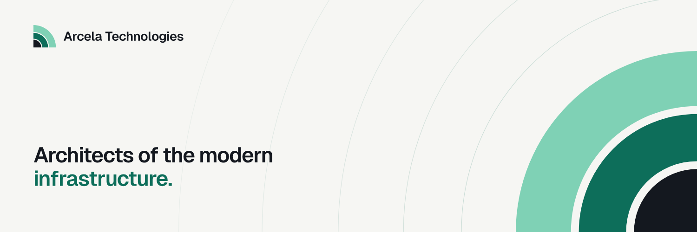 | [`x-header-1500x500.png`](social/x-header-1500x500.png) | X header |

<br>

## Wallpapers

<table>
  <tr>
    <td width="50%"><a href="wallpapers/arcela-desktop-6048x3928.jpg">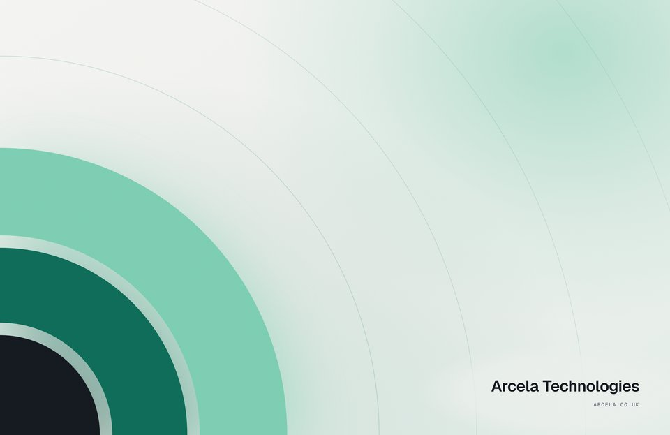</a></td>
    <td width="50%"><a href="wallpapers/arcela-lock-screen-6048x3928.jpg">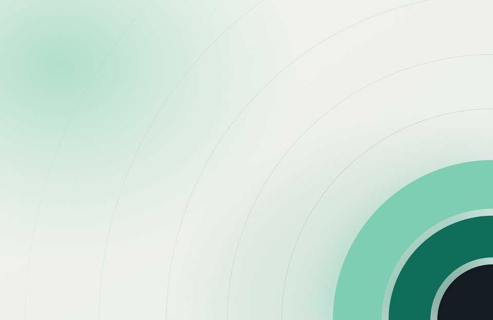</a></td>
  </tr>
  <tr>
    <td align="center"><b>Desktop</b> · 6048 × 3928</td>
    <td align="center"><b>Lock screen</b> · 6048 × 3928</td>
  </tr>
</table>

<br>

## Using the brand

| ✓ Do | ✗ Don't |
|---|---|
| Use the supplied files, unchanged | Recolour, stretch, squash or rotate the logo |
| Pick the version that suits the background | Put the colour logo on busy photos or mid-tone colours |
| Keep the clear space free | Add shadows, glows, outlines or gradients |
| Use the logo to refer to Arcela | Use it to suggest we endorse or partner with you, unless we do |

<br>

## Licence

The **Arcela Technologies** name, the mark and the artwork in this repository belong to **Arcela Technologies Ltd**. You're welcome to use them to refer to Arcela, for example in articles, supplier lists and portfolios, as long as you follow the guidance above. See [`LICENSE.md`](LICENSE.md) for the full terms.

<br>

<p align="center">
  
  <br><br>
  <a href="https://arcela.co.uk"><b>arcela.co.uk</b></a> &nbsp;·&nbsp; <a href="mailto:hello@arcela.co.uk">hello@arcela.co.uk</a>
  <br>
  <sub>Arcela Technologies Ltd · Registered in England and Wales, company number 17556419</sub>
</p>
